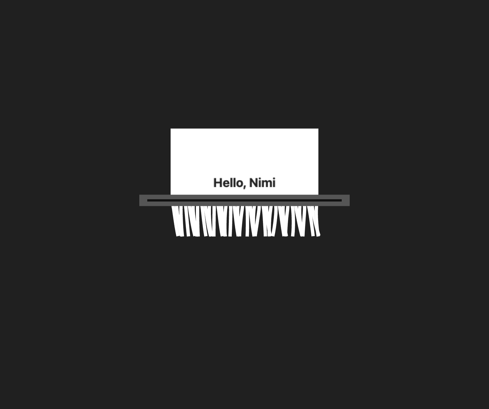

# 碎纸效果:MyGo shader 的 Nimi 复刻

> 日期:2026-11-05 · 对应 M3 动画/效果切片

---

## 1. 来源与判断

用户提供的 MyGo 效果由三部分组成:

1. **36 条纸带 × 24 段 Verlet 物理**
   - 120 Hz 固定步长,重力 700,阻尼 0.994
   - 风场 `windAt(x,y,t)`、尾部锚定槽口、相邻点距离约束
   - 纸带从槽口下送,`top = -height - lead + speed * elapsed`
2. **mask 纹理**
   - `coordinates` shader 把每条纸带的局部 UV 编码到 mask 的 RGBA
   - `shred` LayerEffect:`pos.y < slot` 显示原卡片,否则采样 mask 与源图层
3. **动画驱动**:卡片进入槽口、纸带下落、点击重置。

这不是一段可以直接搬到 Nimi 原生 UI 的代码:当前 Nimi scene 只有
rect/text/clip/image,没有 LayerEffect、shader、mask 纹理和逐帧动画调度。
直接“翻译”shader 需要先有 Metal/离屏纹理/效果图层。

本次先交付两层:

- **纯 Nim 物理**:`src/nimi/effects/shred.nim`,与渲染器无关,供原生
  Metal/scene 后续直接复用;
- **可运行视觉验收**:`examples/shredder`,用 WKWebView + WebGL 渲染纸带纹理。
  WebGL 是 WKWebView 自带的 GPU 路径,不需要新增原生 shader 后端。

## 2. Nim 物理模块

```nim
import nimi

let sim = newShredSim()       # 36 strips, 24 segments, 120 Hz
sim.advance(1.0 / 60.0)      # 累积时间 → 固定子步
for strip in sim.strips:
  for point in strip.nodes:
    echo point.x, ",", point.y
sim.reset()
```

- `ShredConfig` 暴露 MyGo 源码中的参数,方便对齐观感;
- `step` 是固定步长,`advance` 做 accumulator,避免帧率影响物理;
- 坐标是纸面局部空间:x ∈ `0..width`,y 从槽口向下;
- 纯值类型/seq,不依赖 CoreGraphics/WebView,后续 Windows/Linux 也能用。

测试:

```sh
nim c -r --hints:off --path:src tests/test_shred.nim
# [OK] feeds strips through the slot
# [OK] advance uses fixed steps and reset clears state
# [OK] wind field is finite and time-varying
```

## 3. WebGL 视觉 Demo

运行:

```sh
nim c -r --path:src examples/shredder/main.nim
```

- `examples/shredder/frontend` 由 `nimi://` FileServer 提供,验证了
  M5 自定义协议 + 资源目录;
- Demo 里的物理是同一组方程的 JS 版本;Nim 版本在 `effects/shred`,供原生路径复用;
- 页面用 WebGL 纹理四边形渲染 36 条纸带,每条 24 段共享边缘顶点,
  避免 Canvas 2D 逐段重采样产生的接缝;
- 卡片纹理由 Canvas 2D 生成,包含 `Hello, Nimi` 字样;
- 纸带 UV 从纹理的对应 x 切片采样,所以文字会随纸带弯曲、撕裂;
- 槽口以上用 scissor 绘制完整卡片,槽口以下绘制纸带;
- 点击重置;`NIMI_SMOKE=shred` 会推进物理、截图到
  `NIMI_SNAPSHOT`(默认 `/tmp/nimi-shredder.png`)后退出。

冒烟:

```sh
NIMI_SMOKE=shred NIMI_SNAPSHOT=/tmp/nimi-shredder.png \
  nim c -r --path:src examples/shredder/main.nim
# shredder frames: 1
# shredder snapshot: /tmp/nimi-shredder.png
```



截图确认:完整纸卡、槽口、下送纸带、纸带上的文字切片都正确显示。

## 4. 关键决策

| 决策 | 原因 |
|---|---|
| 先做 WebGL demo,而不是直接改原生 scene | 当前原生 scene 无 shader/LayerEffect;WebGL 是 WKWebView 已有能力,可先验证物理与观感 |
| 物理单独抽到 `nimi/effects/shred` | 不让效果逻辑和某个渲染后端绑定;原生/Metal 后续复用 |
| 纸带用共享边缘的纹理四边形 | 解决 Canvas 2D 逐段绘制在弯折处的黑色接缝 |
| 卡片与纸带分槽口上下绘制 | 近似 MyGo 的 `pos.y < Slot` 分支,不引入 mask 纹理 |
| 纸带 UV 反向映射(`v = 1 - k/segments`) | 纸带最早节点对应纸张底边,保证文字方向正确 |
| 动画在页面内驱动 | 不改原生事件循环;后续再补 `Window.requestFrame`/CVDisplayLink |
| 未声称“原生 shader 已完成” | 当前是 WebView/WebGL 视觉验收;原生效果层仍是后续工作 |

## 5. 已知限制

- **不是原生 scene 渲染**:效果跑在 WebGL 中,不经过 Nimi 的
  `scene`/CoreGraphics display list;
- 没有 MyGo 的 mask 纹理和 `LayerEffect`,纸带边缘/覆盖关系是几何近似;
- 文字会被纸带弯折与重叠;当纸带互相遮挡时,部分字块不可见;
- 没有纸张阴影、厚度、双边高光、运动模糊;
- 点击重置通过页面事件;没有原生菜单/快捷键控制;
- `ShredSim` 尚未接入原生 app,原生 PNG/Tester 还没有该效果;
- 动画在页面 `requestAnimationFrame` 中,窗口不可见时可能被系统节流。

## 6. 下一步:原生效果层

1. Scene 增加可扩展绘制 op(或 `opImageQuad` + source rect),先实现
   CPU/CoreGraphics 的纸带纹理四边形。
2. Darwin 增加帧驱动(CVDisplayLink 或 NSTimer),提供
   `Window.requestFrame`/`Animation` API;页面与原生共用同一时钟。
3. 接入 `effects/shred`,把纸带点集转换为纹理四边形。
4. 再考虑 Metal renderer、mask 纹理/`LayerEffect`,对齐 MyGo 的
   `Slot`/`SourceTop`/mask UV 编码。
5. 加 reduced-motion 降级:关闭动画,直接显示静态卡片。
