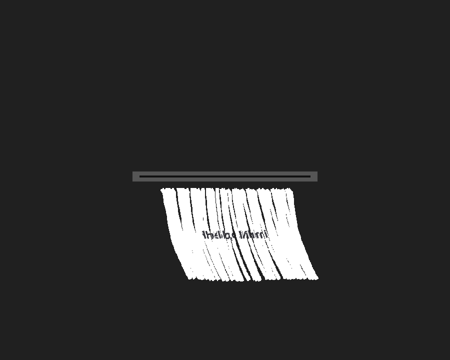

# 原生碎纸效果:帧驱动、纹理四边形与 Metal LayerEffect

> 日期:2026-11-05 · 对应 M3 动画/效果与 M6 Metal 切片

---

## 1. 本次完成

用户要求的四条路径都已落地:

1. **原生帧驱动**:`Window.startAnimation(fps, fn)`;Darwin 后端用 `NSTimer`
   在主 RunLoop 上逐帧回调。窗口关闭时自动 invalidate。
2. **Scene 纹理四边形/源矩形采样**:`scene.imageQuad(path, source, quad)`、
   `scene.polygon(points, color)`;CoreGraphics 渲染器把源矩形裁成小图,
   用两个纹理三角形和仿射变换画到任意四边形。
3. **Metal + mask + LayerEffect**:`src/nimi/render/metal.nim`
   - Mask pass:纸带/卡片四边形写入 RGBA8 mask,`RG` 存 source UV,`A` 存覆盖;
   - Layer pass:全屏 fragment shader 采样 mask,再用 UV 采样纸张纹理;
   - 槽口硬件用 solid pipeline 叠在 LayerEffect 上。
4. **`effects/shred` 驱动原生渲染**:`examples/shred-native`(CoreGraphics)
   和 `examples/shred-metal`(CAMetalLayer)都直接消费 `ShredSim.strips`,
   没有 JS 物理副本。

## 2. 原生 CoreGraphics Demo

```sh
nim c -r --path:src examples/shred-native/main.nim

# 静态验收
NIMI_SMOKE=shred NIMI_SNAPSHOT=/tmp/nimi-shred-native.png \
  nim c -r --path:src examples/shred-native/main.nim

# NSTimer 动画验收
NIMI_SMOKE=live nim c -r --path:src examples/shred-native/main.nim
# native animation frames: 12 elapsed: 0.325
```

实现要点:

- 纸张卡片由离屏 `Scene` + CoreText 生成临时 PNG,再用 `scene.image` 绘制;
- 槽口以下每条纸带的每个 24 分段绘制 `imageQuad`,源矩形对应纸张切片;
- 纸带底部先填充白色 `polygon`,遮住 CPU 两个三角形之间的抗锯齿接缝;
- 点击任意位置重置 `ShredSim`;
- 帧回调只推进物理并让 core 自动 `invalidate`,不直接操作 NSView。


## 3. Metal Demo

```sh
nim c -r --path:src examples/shred-metal/main.nim

# 离屏渲染 + PNG
NIMI_SMOKE=metal NIMI_SNAPSHOT=/tmp/nimi-shred-metal.png \
  nim c -r --path:src examples/shred-metal/main.nim

# CAMetalLayer + NSTimer 实时渲染
NIMI_SMOKE=metal-live \
  nim c -r --path:src examples/shred-metal/main.nim
# metal animation frames: 30 elapsed: 0.49999985 drawable: true
```

Metal 路径:

```text
ShredSim.strips
   │  24-segment quad strip + source UV
   ▼
mask pass (RGBA8, RG=UV, A=coverage)
   ▼
fullscreen LayerEffect shader
   ├─ alpha < .01 → discard
   ├─ uv = mask.rg / mask.a
   └─ source.sample(uv)
   ▼
CAMetalLayer drawable
```

`newMetalShred` 会编译 MSL、创建两个 render pipeline 和 mask/source 纹理;
`renderOffscreen` 用于测试,`renderToLayer` 用于 CAMetalLayer。Shader 和
pipeline 错误会保存在 `MetalShred.error`,不会静默崩溃。



## 4. API 摘要

```nim
# 帧驱动
w.startAnimation(60, proc(time, dt: float64) =
  discard sim.advance(float32(min(dt, 0.12))))
w.stopAnimation()

# Scene 纹理四边形
s.imageQuad(paperPath, srcRect, [
  topLeft, topRight, bottomRight, bottomLeft
])

# Metal
let m = newMetalShred(rgbaPixels, 260, 190)   # mask 1024 x 512
if m.ok:
  discard m.renderOffscreen(sim, 900, 720, slot, cardTop)
  # 或 m.renderToLayer(sim, caMetalLayer, 900, 720, slot, cardTop)
```

新增测试:

- `tests/test_render.nim`:`image quad png`
- `tests/test_metal.nim`:mask + LayerEffect 非空帧、PNG 输出
- `tests/test_shred.nim`:物理约束/固定步长/风场

## 5. 决策

| 决策 | 原因 |
|---|---|
| NSTimer 而不是 CVDisplayLink | 与现有 NSApplication RunLoop 集成最小;60 Hz 效果足够,且窗口关闭可立即 invalidate |
| CPU 路径先做纹理四边形 | 不要求 GPU;保留 CoreGraphics 作为离屏/Tester/降级路径 |
| Metal 用 mask + LayerEffect 两 pass | 对齐 MyGo 的 UV mask 思路;避免在 fragment shader 里维护 864 个节点 |
| mask RG 存 UV、A 存覆盖 | 一个纹理同时表达几何覆盖和源纹理坐标 |
| mask pass 每个 quad 6 顶点 | 与 layer shader 的采样模型直接对应;36×24 规模足够 |
| Metal 仅 macOS | Windows/Linux 需要 D3D11/GL 版本;当前 M8/M9 未开始 |
| 保留 WebGL demo | 便于在无 Metal/无原生窗口环境做视觉对照 |

## 6. 已知限制

- 原生 CoreGraphics 路径每个段仍有两个三角形接缝,用白色底垫遮挡,
  放大看仍有轻微锯齿;
- Metal 路径是专用 `MetalShred`,不是通用的“任意 scene layer + effect”
  合成器;source 图层目前是纸张纹理;
- mask 使用固定 1024×512,窗口尺寸变化时需要重建/重采样(当前 demo
  固定 900×720);
- mask 边缘没有 coverage 抗锯齿;纸带边缘是硬边;
- 没有纸张阴影、厚度、运动模糊、reduced-motion;
- Metal demo 的 CAMetalLayer 尚未接入 `WindowOptions`/Nimi 原生控件树,
  是独立的原生窗口 demo;
- 帧驱动使用 NSTimer,不是 CVDisplayLink;高刷新率屏幕的严格 vsync 后续补。

## 7. 下一步

1. 把 Metal surface 接入 `WindowOptions`/原生 Content,让普通 Nimi 窗口可选用
   Metal LayerEffect,而不是独立 demo。
2. 用 `CGDisplayLink` 或 `CVDisplayLink` 做真正的 vsync 驱动。
3. mask 边缘 coverage/柔化、纸张阴影与厚度。
4. 将 LayerEffect 抽象成通用 scene op,支持任意 source layer。
5. 加 reduced-motion 静态降级和窗口尺寸变化重建。
