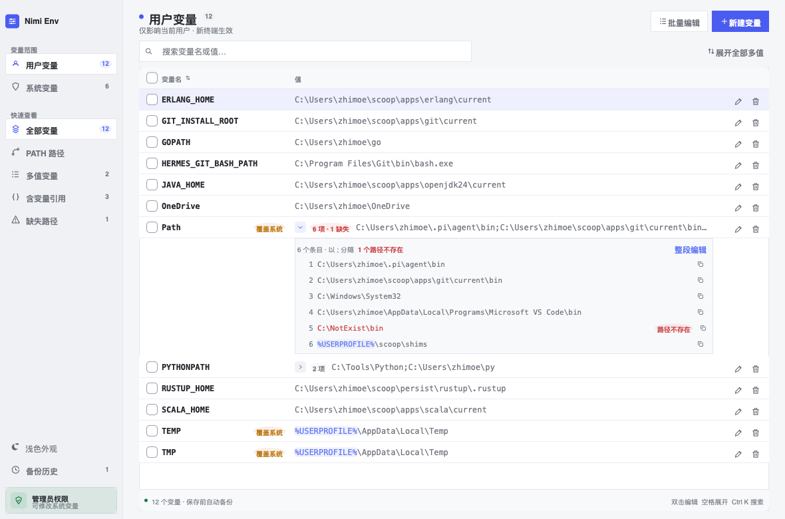

# Nimi Environment Manager

Windows 环境变量编辑器，使用 Nimi 的 Win32 后端、原生 UI、GDI 渲染和注册表存储。界面与 EnvMan 对齐，包含双范围浏览、搜索/筛选、PATH 分项编辑、批量编辑与实时 diff、备份恢复、深浅色主题和 UAC 提权流程。



## 功能

- **双范围**：用户变量与系统变量同时加载；用户变量覆盖系统变量时显示“覆盖系统”，系统侧显示“被覆盖”。
- **快速查看**：全部变量、PATH 路径、多值变量、含变量引用、缺失路径。
- **搜索/排序/多选**：搜索变量名或值；按名称升降序；tri-state 全选；复制、导出 `.env`、批量删除。
- **表格**：等宽变量名、`%VAR%` 与搜索命中高亮；多值变量内联展开，逐条显示、复制、缺失路径提示和“整段编辑”。
- **编辑 sheet**：文本/列表两种模式；列表模式保留原始空项，支持添加/上移/下移/删除；PATH 类变量提示；`%VAR%` 解析预览；值类型与作用范围信息；删除入口。
- **批量编辑**支持行号、不换行、横向滚动和实时解析预览。清空前确认，应用前备份。
- **备份历史**：每次写入前创建整 scope 快照，保留最近 20 份；恢复前再次备份；成功操作可在 8 秒内撤销。
- **主题**：浅色 / 深色 / 跟随系统；持久化到 settings；Windows 标题栏通过 DWM 跟随深色。
- **权限**：系统变量可查看；写入时提示 UAC，提权实例启动后领取 pending 变更并应用；不自动提升整个应用。
- **安全**：不使用会截断长值的 `setx`；只读写 `REG_SZ` / `REG_EXPAND_SZ`，不修改非字符串注册表值；保存前检查目标变量是否被外部修改；保存后广播 `WM_SETTINGCHANGE`。

## 构建与运行

需要 Nim 2.4+。Windows 10/11：

```powershell
# 在仓库根目录
nim c --passL:-Wl,--subsystem,windows -o:NimiEnvironment.exe examples/environment/main.nim
.\NimiEnvironment.exe
```

或使用项目清单构建免安装 exe（会写入 asInvoker/PerMonitorV2/longPathAware manifest）：

```powershell
.\nimi.exe build examples/environment
# 产物：examples/environment/dist/windows-amd64/nimi-environment.exe
```

数据目录默认 `%LOCALAPPDATA%\Nimi\Environment`，可用 `--data-dir=<dir>` 覆盖。`nimi build` 会把 `WebView2Loader.dll` 复制到 exe 同目录；本应用不使用 WebView。

macOS 可以运行离屏截图工具验证共享布局，但不能运行 Windows 应用（注册表和提权 API 只在 Windows 可用）。

## 数据文件

- `snapshots.json`：最近的整 scope 快照（最多 20，最新在前）。
- `pending.json`：等待提权后应用的变更（scope/note/focus/before/desired）。提权实例启动时重命名为 `pending-*.interrupted.json` 再应用，成功后删除；失败保留供排查，不自动重放。
- `settings.json`：主题与窗口尺寸/位置。

## 测试

```sh
# macOS/Linux 可运行的部分：框架、领域、存储、共享 UI、截图
./scripts/test.sh

# 仅环境变量相关
nim c -r --hints:off --path:src tests/test_environment_model.nim
nim c -r --hints:off --path:src tests/test_environment_storage.nim
nim c -r --hints:off --path:src tests/test_environment_app.nim
nim c -r --hints:off --path:src tests/test_environment_ui.nim   # macOS 写出 /tmp/nimi-env-ui-*.png

# Windows 交叉编译（不执行）
./scripts/windows-cross-build.sh
```

Windows CI 会运行真实 Win32 绘制与 HKCU 临时变量测试 `tests/test_environment_app_windows.nim`，并构建 `nimi build examples/environment`。

### 离屏截图

```sh
nim c -r --path:src examples/environment/capture.nim /tmp/nimi-env-shot main
nim c -r --path:src examples/environment/capture.nim /tmp/nimi-env-shot sheet
nim c -r --path:src examples/environment/capture.nim /tmp/nimi-env-shot batch-diff
nim c -r --path:src examples/environment/capture.nim /tmp/nimi-env-shot backups
nim c -r --path:src examples/environment/capture.nim /tmp/nimi-env-shot dark
```

截图使用与窗口相同的 `Tester` 和 CoreGraphics 场景渲染，仅用于布局/视觉预览，不是 Windows GDI 验收。

## 当前限制

- 使用系统标题栏 + DWM 深色，不提供自绘无边框标题栏。
- GDI 渲染；无 D3D11/DirectComposition/DirectWrite，无图像四边形。
- 批量编辑器在长行溢出时显示横向滚动条，可拖动滑块或使用横向滚轮、Shift+滚轮查看。窄窗口把预览放到编辑器下方，通过变量选择器切换目标。
- 应用恢复之前的窗口尺寸和位置，并把整个窗口限制在可用的显示器工作区内。
- 无安装器、代码签名、自动更新和无障碍（UIA）。
- 高对比度使用确定性黑白回退调色板，不读取用户自定义对比色。
- 中文/emoji、微软拼音/日文 IME、候选窗、混合 DPI 多显示器、文本缩放和 DWM 深色标题栏仍需 Windows 实机人工验收；Windows CI 覆盖自动化绘制、注册表 CRUD 和 pending 流程。
- 保存前的比较不是注册表事务：比较与写入之间仍可能有并发修改；同一变量的外部冲突会拒绝保存，无关变量由 merge 保留。
- 空字符串与删除不同；PATH 分项保留空项/空白，批量编辑在应用时会 trim 并丢弃空条目。
